<div align="center">


<br>

[](https://rajdipdhar2007.github.io/Periodic-Table/periodic-table.html)
[](../../stargazers)
[](../../fork)
[](../../issues)


**118 elements. Every atom in 3D. Heatmaps, a heat-it-up slider and a quiz that's hard to put down. One HTML file. Zero build steps.**

</div>


## ⚡ See it in action

<div align="center">

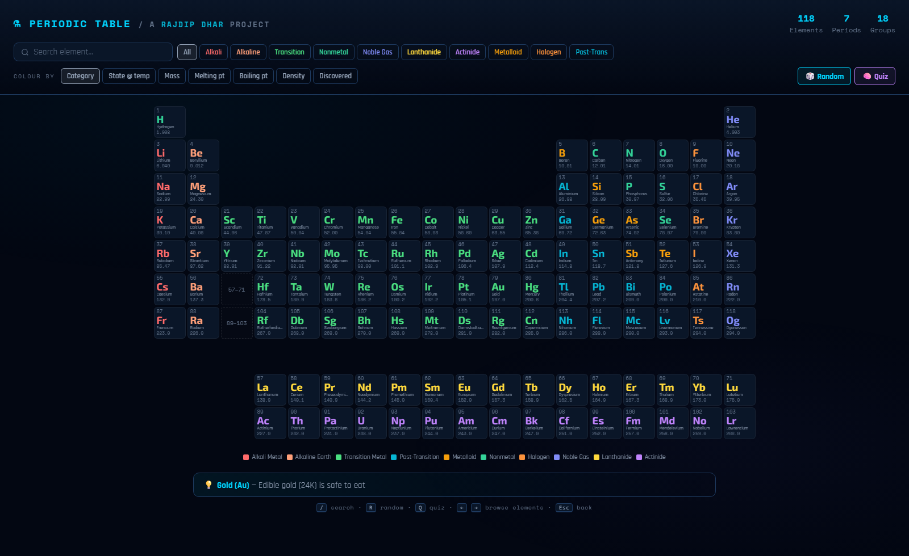

<sub>The full table — centred, colour-coded, with live search and separated lanthanide &amp; actinide rows. Tiles cascade in on load.</sub>

<br><br>

<table>
<tr>
<td width="50%" align="center">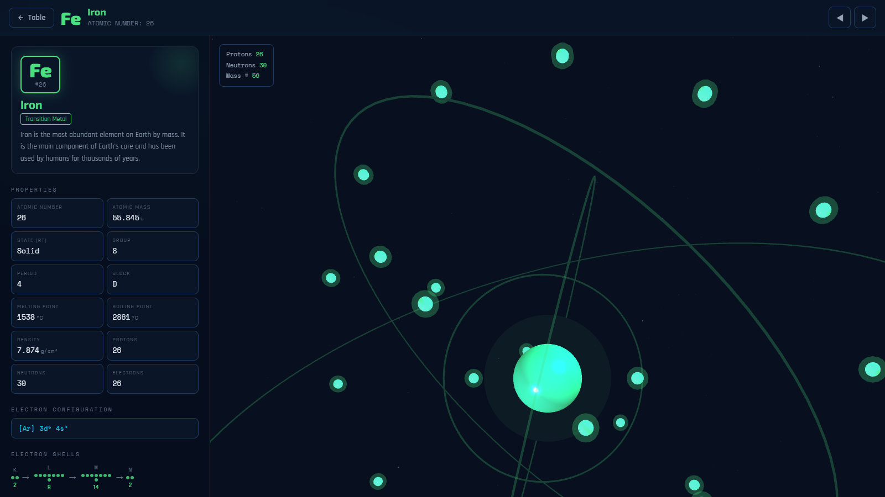<br><sub><b>Iron (Fe)</b> — 26 electrons orbiting in real shells</sub></td>
<td width="50%" align="center">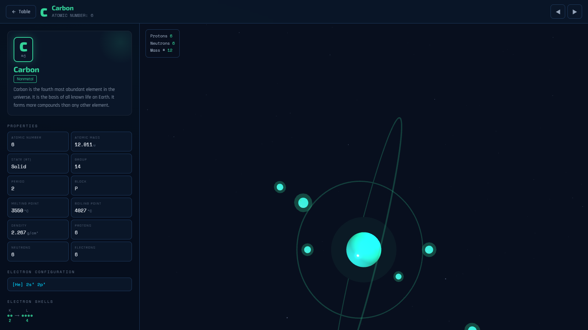<br><sub><b>Carbon (C)</b> — drag, spin, zoom into the nucleus</sub></td>
</tr>
</table>

</div>


## 🔥 New: turn the table into a lab

<div align="center">
<table>
<tr>
<td width="50%" align="center">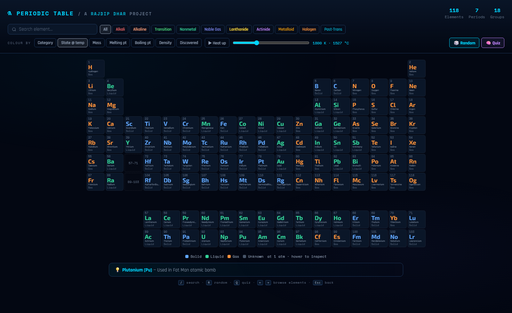<br><sub><b>State @ temperature</b> — drag the slider (or hit <i>▶ Heat up</i>) and watch solids melt and boil</sub></td>
<td width="50%" align="center">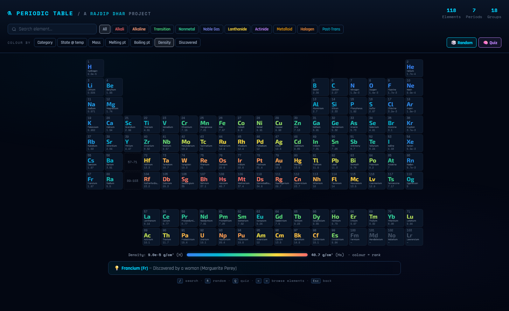<br><sub><b>Density heatmap</b> — instantly see where the heavy hitters live</sub></td>
</tr>
<tr>
<td width="50%" align="center">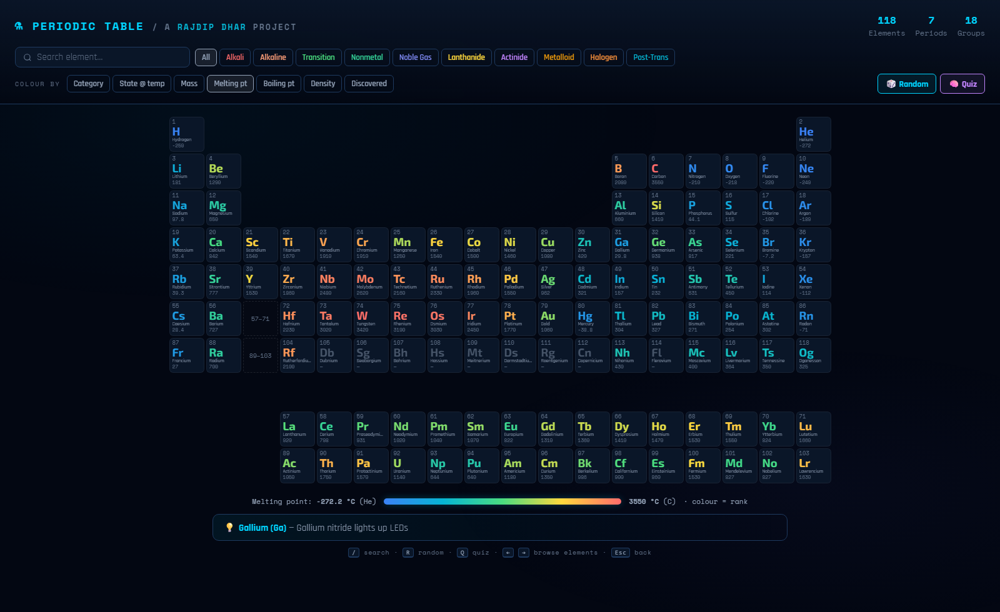<br><sub><b>Melting point</b> — find mercury, gallium and the tungsten extreme</sub></td>
<td width="50%" align="center">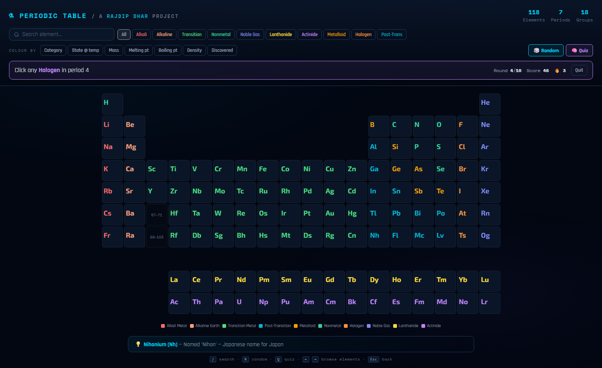<br><sub><b>Quiz mode</b> — names and numbers vanish; you bring the knowledge</sub></td>
</tr>
</table>
</div>

| Feature | What it does |
|---|---|
| 🎨 **Colour-by views** | Recolour all 118 tiles by **mass, melting point, boiling point, density or year of discovery**. Colours use percentile rank, so outliers don't wash out the map, and each tile shows its value. |
| 🌡️ **State @ temperature** | Slide from 0 K to 6000 K and see which elements are **solid, liquid or gas** (at 1 atm). **▶ Heat up** animates the whole table through its phase changes. |
| 🧠 **10-round quiz** | Six question types: find by name, atomic number, a masked description ("Who am I?"), discoverer, electron configuration, or family + period. Streak bonuses, a title at the end (*Curious Beginner → Nobel Laureate*), confetti, and a personal best saved in your browser. |
| 🎲 **Random element** | One click to a random 3D atom. |
| 💡 **Did-you-know ticker** | A rotating fun fact from the dataset — click it to jump to that element. |
| ⌨️ **Keyboard shortcuts** | See below. |
| 🔗 **Shareable views** | Link straight to a view, e.g. `periodic-table.html?view=state&temp=1800` |

### ⌨️ Shortcuts

| Key | Action |
|---|---|
| `/` | Focus search |
| `R` | Random element |
| `Q` | Start / quit the quiz |
| `←` `→` | Previous / next element (on an element page) |
| `Esc` | Back to the table / close dialog / quit quiz |


## 🧪 Why you'll keep clicking

| | |
|---|---|
| 📊 **Complete 118-element grid** | Proper period/group layout with separated lanthanide and actinide rows |
| 🔍 **Instant search** | By name, symbol, or atomic number — results light up as you type |
| 🎛️ **Category filters** | Ten colour-coded families with live highlighting |
| 🧲 **Smart hover tooltips** | Category, group/period, block and state — auto-positioned, never clipped |
| 🌀 **A 3D atom for every element** | Orbiting electron shells, a pulsing nucleus, and a zoom-triggered **nucleus mode** that reveals individual protons and neutrons |
| 🖱️ **Drag, scroll, pinch** | Mouse and touch support for rotating and zooming the model |
| 🔗 **Shareable deep links** | `#element/11` opens Sodium directly — back/forward just work |
| 📱 **Responsive** | Desktop, tablet and phone |
| ✨ **Polished motion** | Staggered tile entrance, glow on hover, smooth recolouring — respects `prefers-reduced-motion` |
| 🪶 **One file** | No framework, no bundler, no `node_modules` |

### 🎨 The ten families

<div align="center">
</div>


## 🚀 Quick start

No install. No build. Just open it.

```bash
git clone https://github.com/RajdipDhar2007/Periodic-Table.git
cd Periodic-Table
```

Then either **double-click `periodic-table.html`**, or serve it:

```bash
npx serve .
# or
python -m http.server 8000
```

…and visit `http://localhost:8000/periodic-table.html`.

> [!NOTE]
> The 3D view loads Three.js and the fonts from a CDN, so you need an internet connection the first time.

## 🎮 How to play

1. **Click** any tile to open its detailed 3D atom page
2. **Type** in the search bar — try `Au`, `iron`, or `79`
3. **Tap a category** to spotlight a whole family
4. **Colour by** density, melting point and more — then hit **State @ temp → ▶ Heat up** and watch the table melt
5. **Drag** to rotate the atom, **scroll / pinch** to zoom — keep zooming in far enough to dive into the **nucleus**
6. **Test yourself** with 🧠 **Quiz** and try to beat your personal best
7. **Share** any element with its URL, e.g. `periodic-table.html#element/79`

## 🛠️ Built with

| Layer | Tech |
|---|---|
| Markup / style / logic | Vanilla HTML · CSS · JavaScript — no frameworks |
| 3D atoms | [Three.js](https://threejs.org/) (CDN) |
| Typography | [Exo 2](https://fonts.google.com/specimen/Exo+2) · [Space Mono](https://fonts.google.com/specimen/Space+Mono) · [Rajdhani](https://fonts.google.com/specimen/Rajdhani) |

Works in any modern browser with WebGL — Chrome, Edge, Firefox, Safari.

## 🗂️ Project layout

```text
Periodic-Table/
├── periodic-table.html     ← the entire app
├── assets/                 ← README art (animated SVGs + screenshots)
├── .github/                ← issue & PR templates
├── CONTRIBUTING.md
├── CODE_OF_CONDUCT.md
├── SECURITY.md
└── LICENSE
```

## 🤝 Contribute

Found a wrong melting point? Want a new view, a dark/light toggle, isotopes, or electron orbitals? Jump in — see [`CONTRIBUTING.md`](CONTRIBUTING.md), or open an [issue](../../issues/new/choose).


<div align="center">

<a href="../../stargazers"></a>

<sub>Every ⭐ is a proton in this project's nucleus — it keeps the whole thing stable. Thank you!</sub>

<br>

[](https://github.com/RajdipDhar2007)
[](mailto:rajdipdharcode@gmail.com)

**Distributed under the [MIT License](LICENSE).**

</div>
